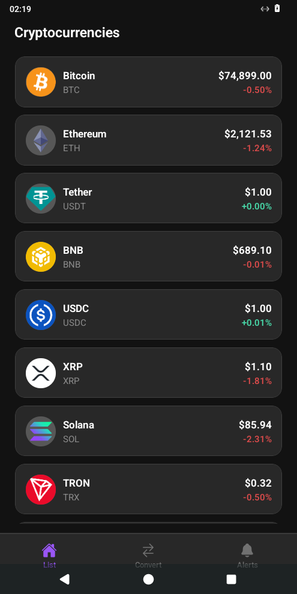
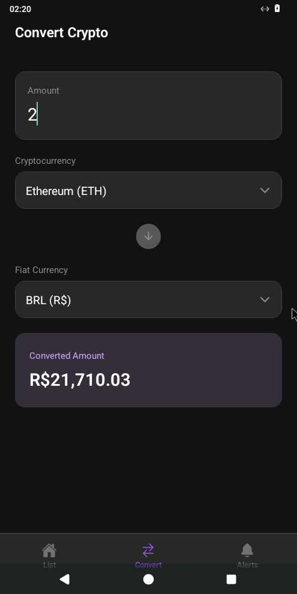
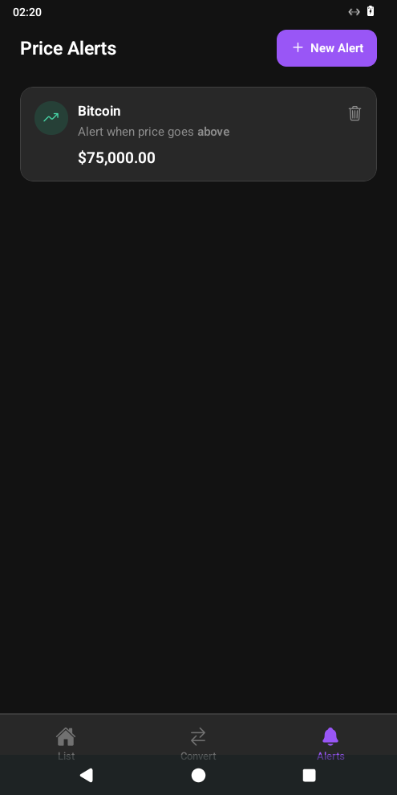
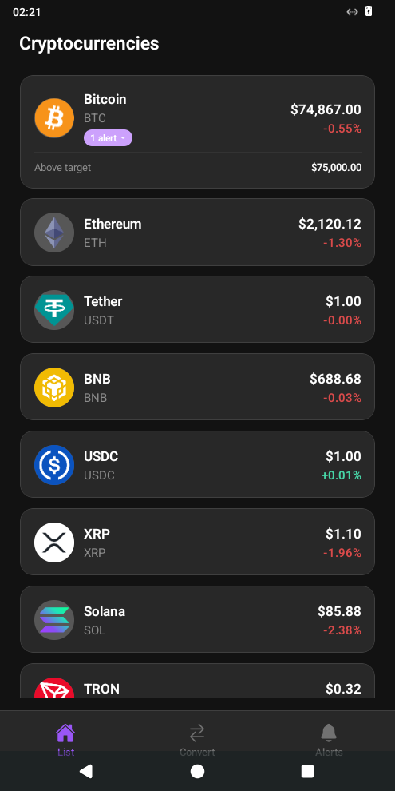
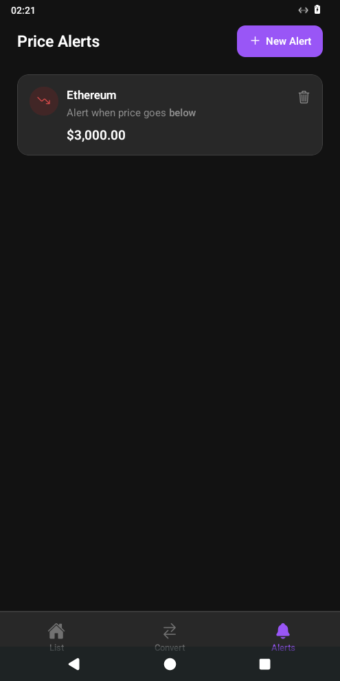

# Crypto Alert — Testes End-to-End (E2E) com Maestro e IA Generativa

Este repositório contém a aplicação **React Native Crypto Alert** (Expo Router + TypeScript) instrumentada com testes End-to-End (E2E) automatizados utilizando o **[Maestro](https://maestro.mobile.dev/)**, desenvolvidos com apoio de Inteligência Artificial Generativa e validados manualmente no aplicativo a partir do estudo do artigo:

> **GenIA-E2ETest: A Generative AI-Based Approach for End-to-End Test Automation**  
> Elvis Júnior, Alan Valejo, Jorge Valverde-Rebaza, Vânia de Oliveira Neves — [arXiv:2510.01024](https://arxiv.org/abs/2510.01024) (SBES).

---

## Estrutura da Entrega

| Arquivo / Pasta | Descrição |
|---|---|
| [`reflexao.md`](./reflexao.md) | **Parte 1:** Respostas autorais às 5 questões sobre o artigo *GenIA-E2ETest*, limitações de LLMs em testes E2E, necessidade de revisão humana e validação prática com Maestro. |
| [`ia/planejamento.md`](./ia/planejamento.md) | **Parte 3:** Registro do prompt utilizado, resposta original da IA, cenários selecionados e análise crítica detalhada (o que foi aproveitado, corrigido ou descartado em função do código real do app). |
| [`.maestro/`](./.maestro) | **Parte 4:** Quatro fluxos E2E em YAML validados na interface real do aplicativo (`com.anonymous.cryptoalert`). |
| [`docs/evidencias/`](./docs/evidencias) | **Evidências de Execução:** Capturas de tela e logs dos fluxos executados no dispositivo Android via Maestro. |

---

## Pré-requisitos

- **Node.js** (v18+ ou v20+) e **npm**
- **Java JDK 17+** (`java -version`) — necessário para o Gradle e para o Maestro CLI
- **Android SDK** com `adb` (`platform-tools`) configurado no `PATH` e um **Emulador Android** (AVD / Waydroid) ou dispositivo físico conectado (ou Xcode + Simulador iOS no macOS)
- **Maestro CLI** (`v2.x`)

---

## 1. Instalação do Projeto

Clone o repositório e instale as dependências:

```bash
git clone https://github.com/MICAELCARDOSOREIS/react-native-crypto-alert.git
cd react-native-crypto-alert
npm install
```

---

## 2. Como Abrir o Emulador / Simulador e Gerar a Versão Nativa

> **Importante:** O aplicativo nativo (`com.anonymous.cryptoalert`) deve estar compilado e instalado no emulador ou dispositivo **antes** da execução dos testes E2E com o Maestro.

### Opção A — Android (Emulador Android Studio / AVD ou Waydroid)

1. **Inicie o emulador Android:**
   - Pelo Android Studio (*Device Manager* → *Start*), via linha de comando:
     ```bash
     $ANDROID_HOME/emulator/emulator -avd <NOME_DO_SEU_AVD>
     ```
   - Ou, caso utilize **Waydroid** no Linux:
     ```bash
     waydroid session start &
     adb connect 192.168.240.112:5555
     ```
2. **Confirme que o dispositivo está conectado e autorizado no ADB:**
   ```bash
   adb devices
   ```
3. **Gere a pasta nativa Android (`prebuild`) e instale o aplicativo no dispositivo:**
   ```bash
   # Opção 1: Executar diretamente via Expo CLI (gera a build nativa e instala)
   npx expo run:android

   # Opção 2: Gerar diretórios nativos, compilar o APK standalone e instalar via ADB
   npm run prebuild:android
   cd android && ./gradlew assembleDebug && cd ..
   adb install -r android/app/build/outputs/apk/debug/app-debug.apk
   ```

### Opção B — iOS (Simulador no macOS)

1. Abra o Simulador iOS:
   ```bash
   open -a Simulator
   ```
2. Gere e instale a versão nativa iOS:
   ```bash
   npx expo run:ios
   ```

---

## 3. Instalação e Configuração do Maestro

Instale o Maestro CLI executando o script oficial:

```bash
curl -Ls "https://get.maestro.mobile.dev" | bash
export PATH="$PATH:$HOME/.maestro/bin"
```

Verifique se a instalação foi concluída com sucesso:

```bash
maestro --version
```

---

## 4. Como Executar os Testes E2E

Com o emulador/dispositivo aberto e o aplicativo `com.anonymous.cryptoalert` instalado:

### Executar todos os 4 fluxos em sequência

```bash
maestro test .maestro/
```

### Executar cada fluxo individualmente

```bash
# Fluxo 01: Listagem de criptomoedas e navegação entre as 3 abas (List, Convert, Alerts)
maestro test .maestro/01_listagem_e_navegacao_abas.yaml

# Fluxo 02: Conversão reativa de criptomoedas e troca nos modais (BTC -> ETH e USD -> BRL)
maestro test .maestro/02_conversao_criptomoedas.yaml

# Fluxo 03: Criação de alerta de preço (Above target) e expansão do badge "1 alert" na aba List
maestro test .maestro/03_criar_alerta_e_validar_badge_na_lista.yaml

# Fluxo 04: Criação de alerta (Below target), exclusão ("Delete alert") e retorno ao EmptyState
maestro test .maestro/04_excluir_alerta_e_estado_vazio.yaml
```

---

## 5. Resumo dos Fluxos E2E Implementados (`.maestro/`)

| Arquivo | Cenário Validado | Seletores Reais Utilizados |
|---|---|---|
| [`01_listagem_e_navegacao_abas.yaml`](./.maestro/01_listagem_e_navegacao_abas.yaml) | Carregamento da lista de criptomoedas e navegação pelas abas inferiores (`List`, `Convert`, `Alerts`). | `"Cryptocurrencies"`, `"Bitcoin"`, `"BTC"`, `"Ethereum"`, `"Convert"`, `"Convert Crypto"`, `"Enter an amount"`, `"Alerts"`, `"Price Alerts"`, `"No alerts yet"` |
| [`02_conversao_criptomoedas.yaml`](./.maestro/02_conversao_criptomoedas.yaml) | Conversão reativa ao digitar quantidade e troca de criptomoeda e moeda fiduciária nos modais `SelectField`. | `"0.00"`, `"Bitcoin (BTC)"` → modal `"Ethereum"` → `"Ethereum (ETH)"`, `"USD ($)"` → modal `"BRL"` → `"BRL (R$)"`, regex `"R\\$.*"` |
| [`03_criar_alerta_e_validar_badge_na_lista.yaml`](./.maestro/03_criar_alerta_e_validar_badge_na_lista.yaml) | Navegação (`"Go back"`), criação de alerta de preço (`Above target price`) para Bitcoin e expansão do badge `"1 alert"` no card da tela inicial. | `"Create Alert"`, `"Go back"`, `"New Alert"`, `"Select cryptocurrency"`, `"Bitcoin"`, `"0.00"`, `"Above target price"`, `"Save Alert"`, `"$75,000.00"`, `"1 alert"`, `"Above target"` |
| [`04_excluir_alerta_e_estado_vazio.yaml`](./.maestro/04_excluir_alerta_e_estado_vazio.yaml) | Criação de alerta (`Below target price`) para Ethereum, exclusão via ícone de lixeira e verificação do retorno ao `EmptyState`. | `"New Alert"`, `"Select cryptocurrency"`, `"Ethereum"`, `"Below target price"`, `"Save Alert"`, `"Alert when price goes below"`, `"$3,000.00"`, `accessibilityLabel` `"Delete alert"`, `"No alerts yet"` |

---

## 6. Evidências de Execução dos Fluxos

As capturas de tela abaixo foram geradas diretamente durante a execução automatizada dos fluxos pelo Maestro no dispositivo Android:

| Fluxo 01 — Listagem Inicial | Fluxo 02 — Conversão ETH para BRL |
|---|---|
|  |  |

| Fluxo 03 — Alerta Criado em Price Alerts | Fluxo 03 — Badge `"1 alert"` Expandido na Home |
|---|---|
|  |  |

| Fluxo 04 — Alerta Below Target Antes de Excluir | Fluxo 04 — Retorno ao Estado Vazio Após Exclusão |
|---|---|
|  |  |
